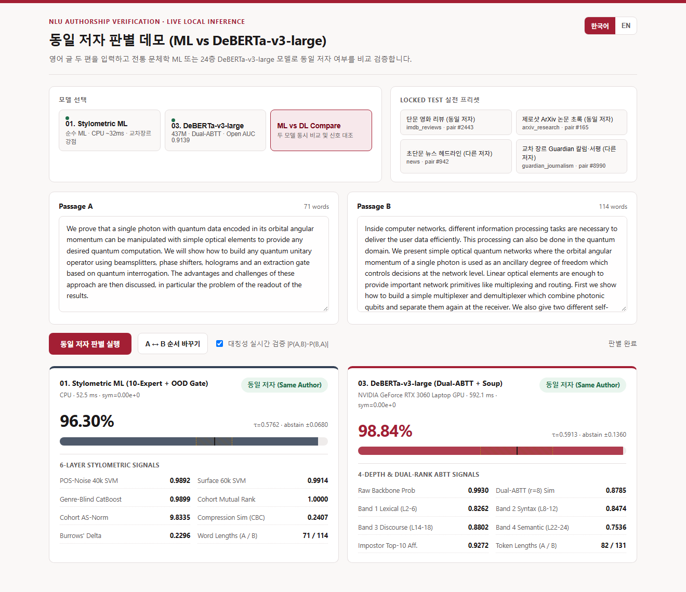
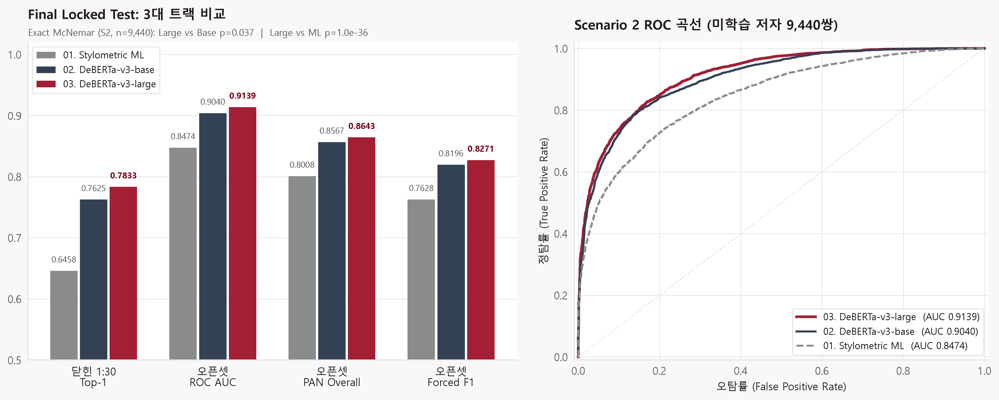
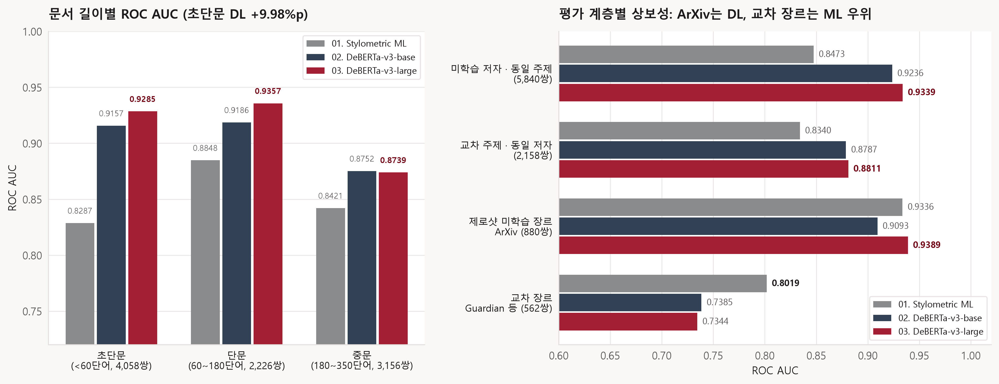
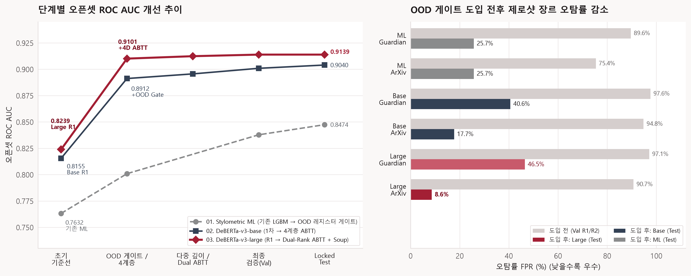

# 동일 저자 판별 · 순수 문체학 ML vs DeBERTa-v3

[English](README.md) | [시스템 구조](docs/architecture.ko.md) | [설계 판단과 개선 과정](docs/methodology-and-decisions.ko.md) | [전체 실험 결과](docs/results.ko.md) | [재현 및 데모 실행](docs/reproduction.ko.md)

영어 글 두 편(문서당 최대 `512` 토큰, 쌍 합산 `1,024` 토큰 예산)을 입력받아 동일 저자 여부를 추정하는 자연어 이해 프로젝트입니다. 보정된 동일 저자 확률, 분류 또는 PAN 판정 보류(`uncertain`), 순서 불변 대칭성(`|P(A, B) - P(B, A)| = 0.00`), 그리고 모델별 근거 신호(문체 지표 또는 4계층 언어 깊이 유사도)를 함께 제공합니다.

전통 문체학과 딥러닝의 실질적인 차이와 상호보완성을 공정하게 검증하기 위해 **Train · Validation · Locked Test 간 저자 교집합 0명(Dual-Author-Disjoint)** 벤치마크 위에서 **피처·예측값을 일절 혼합하지 않은 3개 독립 트랙**을 비교했습니다.

1. **Track 01 (`01_stylometric_ml`)**: 6계층 문체 특징(`6,001`차원) + 10종 다중 스케일/디바이어싱 전문가(`LightGBM`·`CatBoost`·`Linear`) + 내재적 OOD 레지스터 게이트 메타 보정기 (`21.63 MB`, CPU `32.1 ms/pair`).
2. **Track 02 (`02_deberta_v3_base`)**: 12층 대칭 샴 `microsoft/deberta-v3-base` (`185.97M`) + Greedy Model Soup + 4계층 `All-but-the-Top (r=3)` 잔차 OOD 게이트.
3. **Track 03 (`03_deberta_v3_large`)**: 24층 대칭 샴 `microsoft/deberta-v3-large` (`436.64M`) + LLRD·Prior WD + 체크포인트 보간 수프(`0.65 / 0.35`) + 4계층 Multi-Std + Dual-Rank `All-but-the-Top (r=3, 8)` + 대칭 합의축 PCA(`e1 * e2`) + 5-Seed 잔차 OOD 게이트.



---

## 핵심 검증 결과

모든 임계값(`tau`, `delta`, 귀납적 `CSLS` 가중치 `hw`)은 Validation에서 고정한 뒤 Locked Test(`1:30` 닫힌 집합 `240` 쿼리 / `18,000`쌍, 오픈셋·교차 주제·제로샷 장르 `9,440`쌍)를 단 1회 평가했습니다(상세 표: [전체 실험 결과](docs/results.ko.md)).

| 트랙 | Closed 1:30 Top-1 | Closed 1:30 Top-3 | Closed Macro F1 | Open ROC AUC | PAN c@1 | PAN F_0.5u | PAN Brier | PAN Overall | Forced Macro F1 | 속도 / 크기 |
| :--- | :---: | :---: | :---: | :---: | :---: | :---: | :---: | :---: | :---: | :---: |
| `01. Stylometric ML` | 64.58% | 84.58% | 0.5359 | 0.8474 | 0.7819 | 0.7823 | 0.8387 | 0.8008 | 0.7628 | 32.1 ms (CPU) · 21.6 MB |
| `02. DeBERTa-v3-base` | 76.25% | **91.25%** | 0.6363 | 0.9040 | 0.8443 | 0.8414 | 0.8724 | 0.8567 | 0.8196 | 186.0M params |
| **`03. DeBERTa-v3-large`** | **78.33%** | **91.25%** | **0.6547** | **0.9139** | **0.8556** | **0.8461** | **0.8779** | **0.8643** | **0.8271** | 32.5 ms (L4) · 860.3 MB |

**쌍대 통계적 유의성 검정 (Exact McNemar + Paired Bootstrap 95% CI):**
- `Large vs ML` (Scenario 2, 9,440쌍): `n10 = 1,450` vs `n01 = 846`, `p = 1.01e-36`, 정확도 차 `+6.40% [+5.40%, +7.38%]`, AUC 차 `+6.65% [+5.90%, +7.39%]`.
- `Large vs Base` (Scenario 2, 9,440쌍): `n10 = 601` vs `n01 = 530`, `p = 0.03735`, 정확도 차 `+0.75% [+0.08%, +1.45%]`, AUC 차 `+0.99% [+0.63%, +1.37%]`.
- `Large vs ML` (Scenario 1, 240쿼리): `n10 = 53` vs `n01 = 20`, `p = 1.42e-04`, 정확도 차 `+13.75% [+7.08%, +20.83%]`.



### 패러다임 상호보완성: 딥러닝과 문체학 ML의 영역 차이
- **초단문 (`60단어 미만`, 4,058쌍)**: 빈도 통계가 희소해지는 구간에서 `DeBERTa-v3-large`(`0.9285`)가 `Stylometric ML`(`0.8287`)을 **`+9.98%p`** 앞섭니다.
- **제로샷 학술 논문 (`arxiv_research`, 880쌍)**: 24층 확장과 Dual-Rank ABTT로 `Large`가 `Base`(`0.9093`)를 넘어 **`0.9389`**를 기록하며 `ML`(`0.9336`)까지 역전했습니다.
- **교차 장르 저널리즘 (`cross_genre` / `guardian_journalism`, 562쌍)**: 칼럼·사설·서평 간 편집 양식이 크게 바뀌는 구간에서는 명시적 `POS-Noise`와 기능어 편차 비중이 큰 `Stylometric ML`(`0.8019`)이 딥러닝(`0.7344`)보다 높은 판별력을 유지합니다.



---

## 시스템 구조 및 핵심 기법

모든 구조 변경은 Validation 오차 진단에서 확인된 구조적 병목을 겨냥해 도입했고, 실측에서 불리한 가설은 기각했습니다. 상세 아키텍처와 의사결정 기록은 [시스템 구조](docs/architecture.ko.md) 및 [설계 판단과 개선 과정](docs/methodology-and-decisions.ko.md)에 정리했습니다.

### 1. 벤치마크 재설계 (`benchmark_1024`)
초기 개발 분할에서는 같은 글이나 저자가 학습과 평가에 중복 포함되어 주제·문서 암기로 성능이 과대평가되는 한계가 있었습니다. 이를 해소하기 위해 9개 도메인에서 Train(`84,860`쌍), Validation(`8,540` 오픈쌍 + `150` 닫힌 쿼리), Locked Test(`9,440` 오픈쌍 + `240` 닫힌 쿼리) 간 **저자 중복 0명**을 강제하고, `60%` 동일 주제 오답 함정과 완전 미학습 제로샷 장르(`arxiv_research`, `guardian_journalism`)를 배치했습니다. 모든 OOF 보정기는 한쪽 저자만 분리하는 `GroupKFold` 대신 `(bucket(a1) != k) & (bucket(a2) != k)` **5-Bucket 양방향 저자 배제 OOF**를 적용했습니다.

### 2. Track 01: 6계층 문체 특징 + 내재적 OOD 레지스터 게이트
- **주제 어휘 지름길 억제**: 단순 표면 `TF-IDF`는 같은 주제를 다룬 다른 저자에 쉽게 속습니다. 원문을 3중 뷰(`Surface` 원문 / `POS-Noise` 내용어 마스킹 / `Distorted` 리듬)로 분해하고 256 사칭자 `AS-Norm` 및 `64-Bag Koppel` 승률을 결합해 Val Open AUC를 `0.7632`(기존 단일 LGBM)에서 `0.8009`로 끌어올렸습니다.
- **로짓 진폭 정렬과 노이즈 가지치기 (Round 2)**: 미보정 LightGBM 로짓(`±6`)이 CatBoost·선형 모델(`±2.5`)과 진폭이 달라 앙상블 가중치가 0으로 붕괴하는 현상을 폴드 내부 온도 보정으로 해결했고, Gain이 0인 `1,702`개 열을 제거(`6,001 → 1,500`)했습니다.
- **제로샷 레지스터 착시 교정 (Round 3)**: `Guardian`(`FPR 89.6%`)과 `ArXiv`(`FPR 75.4%`)에서 격식체·학술 문서 쌍이 구어체 사칭자 코호트보다 서로 비슷해 보여 오탐이 치솟는 원인을 규명했습니다. 도메인 라벨 없이 표면 어휘를 제거한 **Genre-Blind Pure Delta CatBoost(`642`열)**와 사칭자 친화도·격식도·모델 불일치도를 읽는 **OOD 레지스터 게이트**를 도입해 Test FPR을 두 도메인 모두 **`25.7%`**로 낮추고 `ROC AUC 0.8474` (`PAN Overall 0.8008`)를 달성했습니다.

### 3. Tracks 02 & 03: 대칭 샴 DeBERTa-v3 + Dual-Rank ABTT 보정
- **백본 선택**: `DeBERTa-v3`의 분리형 상대 위치 어텐션은 문장 호흡·구두점 간격·구문 리듬을 절대 위치 인코더보다 정밀하게 보존하며, `(u+v)/2`, `|u-v|`, `u*v`, `(u-v)^2`, `cos` 대칭 결합으로 순서 오차 `0.00`을 보장합니다.
- **`transformers 5.x` FP16 언더플로 원인 규명**: 초기 `DeBERTa-v3` 학습이 `loss = 0.6965`에 정체된 원인을 추적해 `transformers 5.x`가 Hub의 `float16` 가중치를 그대로 FP16으로 적재해 `AdamW(1.6e-5)` 갱신이 매 스텝 0으로 반올림 소멸함을 밝혔고, `.float()` FP32 마스터 가중치 강제로 수렴을 복구했습니다.
- **통제 절제 실험(Base)과 4-Way HP 프로브(Large)**:
  - **채택**: 상위 50% 학습 가능 층 가중 풀링(`L7~L12` / `L13~L24`), 어텐션 통계 풀링(`ASP`), 5-branch MSD, 문중 고유명사 15% 마스킹, `shuffle=True`, 24층 Large에서의 `LLRD(gamma=0.94868) + Prior WD(0.01) + Pure Label-Smoothed BCE`(10% 프로브에서 균일 학습률 대비 Composite `+3.70%p`).
  - **기각**: 도메인순 정렬 `shuffle=False`(앞 도메인 망각으로 Val AUC `-1.56%p`) 및 보조 `CoSENT` 순위 손실(순수 BCE 대비 열세).
- **4계층 언어 깊이 + Dual-Rank `All-but-the-Top (r=3, 8)` + 보간 수프(`0.65 / 0.35`)**: 24개 층에서 4개 언어 깊이(`L2~L6` 어휘·구두점, `L8~L12` 구문, `L14~L18` 담화 평균+표준편차, `L22~L24` 의미)를 추출하고 256개 고정 학습 사칭자의 상위 3축·8축 주제 성분을 직교 제거했습니다. 여기에 대칭 합의축 PCA(`e1 * e2`, 16d)와 상위 두 스냅샷 선형 보간 수프(`0.65 * step_4141 + 0.35 * step_4970`)를 결합해 `ArXiv` Test FPR을 `90.7% → 8.6%`(`ROC AUC 0.9389`)로 낮추고 최종 Locked Test `ROC AUC 0.9139`를 기록했습니다.



---

## 로컬 실행 및 데모

로컬 웹 데모에서 영어 글 두 편을 입력하고 **`01. Stylometric ML`**, **`03. DeBERTa-v3-large`**, 또는 **`ML vs DL 동시 비교`** 모드를 선택해 실시간으로 판별할 수 있습니다. `A ↔ B 순서 바꾸기`로 대칭성(`0.00`)을 직접 검증하고, Locked Test 실전 프리셋 4종과 모델별 근거 신호를 확인할 수 있습니다.

```powershell
# 1. 의존성 설치
pip install -r requirements.txt

# 2. Google Drive에서 공개 모델 가중치 다운로드 (ML 21.6 MB / DL 860.3 MB)
python verify_author.py download --model ml
python verify_author.py download --model dl

# 3. 로컬 인터랙티브 웹 데모 실행 (http://127.0.0.1:8000)
.\launch-nlu.bat demo
# Linux / macOS:
sh ./launch-nlu.sh demo

# 4. 명령줄(CLI)에서 바로 판별
python verify_author.py predict --model both --check-symmetry --text-1 "First passage..." --text-2 "Second passage..."
```

### Google Drive 공개 아카이브 및 Colab 학습 링크
- **전체 공개 폴더**: [Google Drive / NLU 아카이브](https://drive.google.com/drive/folders/1ij9ZwlLtimS26bAE9B_D5zL3raAKJody)
- **벤치마크 데이터셋**: [benchmark_1024.zip (61.2 MB)](https://drive.google.com/file/d/1Y9xfMRskEUZPYw9f5jdiM6ws9L-Cwdr8/view)
- **Track 01 (`Stylometric ML`)**: [train_01_stylometric_ml.ipynb (Colab)](https://colab.research.google.com/drive/1jAuZKPe7mcuL9jB9SAIQmGr-jQ-CdjtJ) · [model_01_stylometric_ml.joblib](https://drive.google.com/file/d/1q9T8zLYmnhLqPWT9He8wiqIjA0kvCR1M/view) · [results_01_stylometric_ml.zip](https://drive.google.com/file/d/1ZW4ib1SdDZPzGV1DHB3nREv8Mp7x-VfE/view)
- **Track 02 (`DeBERTa-v3-base`)**: [train_02_deberta_v3_base.ipynb (Colab)](https://colab.research.google.com/drive/1U6Fv97IcC061XdJlVYWM79D9YSOsD9Bk) · [results_02_deberta_v3_base.zip](https://drive.google.com/file/d/1WjbhPHpdcCVGA8w0fQAyoDd7zMjnDmGO/view)
- **Track 03 (`DeBERTa-v3-large`)**: [train_03_deberta_v3_large.ipynb (Colab)](https://colab.research.google.com/drive/1ROS0vdfbpZupVoM38Dz41eDB1tCAGjWL) · [model_03_deberta_v3_large.pt](https://drive.google.com/file/d/1r19ezaf0Q_nn3qVS43m4nDhAs5jfGkve/view) · [results_03_deberta_v3_large.zip](https://drive.google.com/file/d/15D12EdLfD1oeR-xfAcaM24OvRS9Vs3w-/view)

---

## 소프트웨어 검증

```bash
pytest -v tests/test_inference_and_demo.py
```

배포용 가중치 2종(`model_01_stylometric_ml.joblib` 순수 Python 내장 타입, `model_03_deberta_v3_large.pt` 순수 텐서)에 대해 웹 API, 프리셋 구조, 순서 대칭성(`0.00e+00`), Locked Test 원기록 정합성(`24/24` 판정 일치, 평균 확률 차 `0.0011`)을 자동 검증하며, [GitHub Actions CI](.github/workflows/cpu-runtime.yml)에서 매 커밋 테스트를 실행합니다.

---

## 저장소 구성

```text
nlu_authorship/          ML·DL 독립 추론 엔진, Google Drive 다운로더, 로컬 웹 데모 서버
notebooks/colab/         단일 실행 재현용 최종 학습 노트북 3종 (01 ML, 02 Base, 03 Large)
scripts/                 벤치마크 빌더, 무결성 검증, 노트북 생성기, 한·영 MIT Red 차트 렌더러
docs/                    영문·국문 구조, 설계 판단, 실험 결과, 재현 안내 문서 및 차트
model-cards/             Track 01 (Stylometric ML) 및 Track 03 (DeBERTa-v3-large) 모델 카드
reports/                 검증된 요약 JSON 및 3대 모델 통계 비교 CSV
tests/                   단위·웹 API·순서 대칭성·Locked Test 정합성 테스트
verify_author.py         CLI 및 웹 데모 실행기 (launch-nlu.bat / launch-nlu.sh 지원)
```

---

## 적용 범위 및 한계

`DeBERTa-v3` 트랙은 문서당 `512`토큰(쌍 합산 `1,024`토큰) 예산으로 입력을 제한하므로 장문 원고에서는 후반부 절단이 발생합니다. 또한 개인 블로그(`blogs`)처럼 단일 저자 내 주제·어조 변동이 큰 도메인에서는 Closed 1:30 Top-1이 `50.00%`에 머물고, PAN 보류(`15.15%`) 적용 시에도 응답 사례 중 약 `12.4%`의 오답 가능성이 남아 있습니다. 따라서 본 시스템은 법의학적 신원 증명이나 표절 단정이 아닌 **확률적 문체 분석 보조 지표**로 해석해야 합니다.
