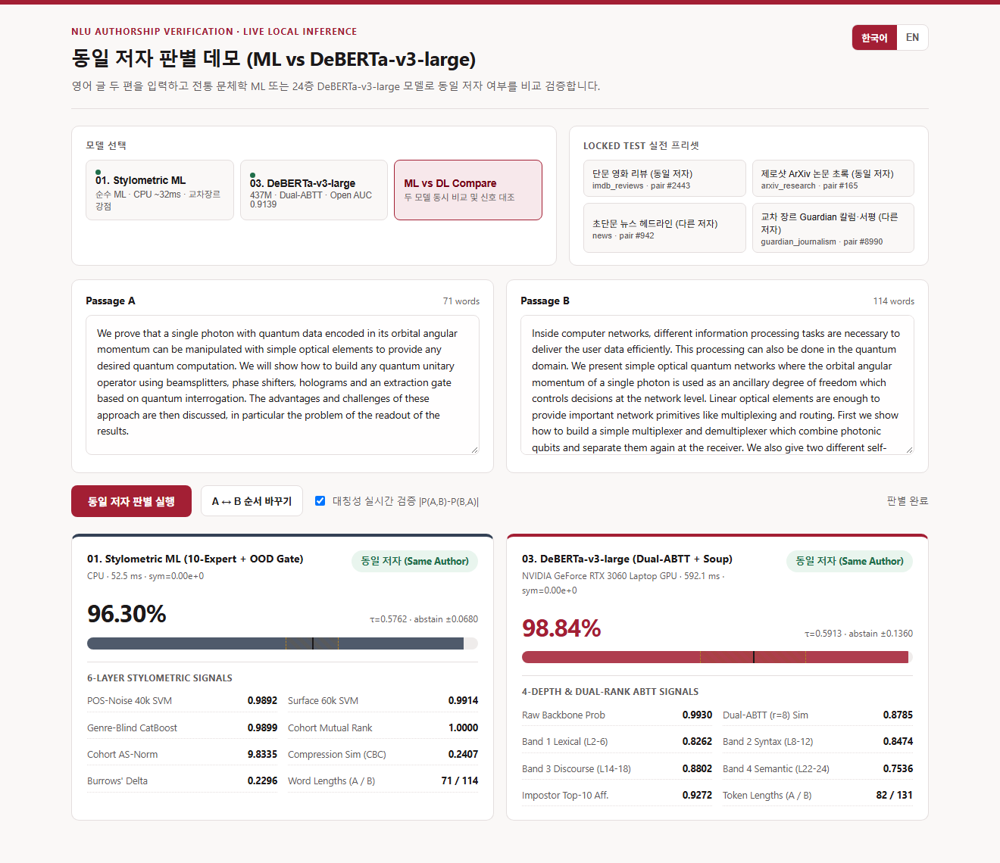
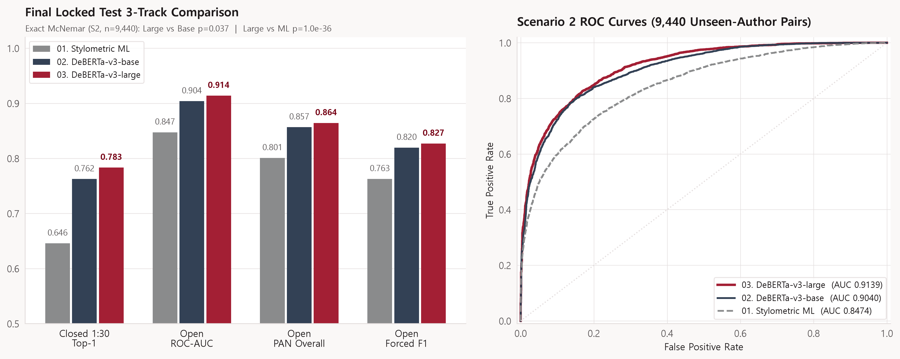
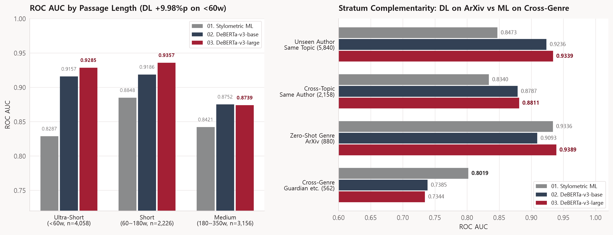
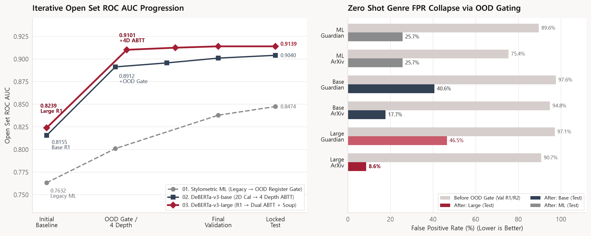

# Authorship Verification · Stylometric ML vs DeBERTa-v3

[한국어](README.ko.md) | [Architecture](docs/architecture.md) | [Design Decisions & Progression](docs/methodology-and-decisions.md) | [Results](docs/results.md) | [Reproduction & Demo](docs/reproduction.md)

Compare two English passages (`<= 512` tokens each, `1,024`-token combined budget) to estimate whether they were written by the same author. The system outputs a calibrated same-author probability, a classification or PAN abstention (`uncertain`) decision, exact order-symmetry verification (`|P(A, B) - P(B, A)| = 0.00`), and per-feature or per-depth diagnostic signals.

To rigorously compare traditional stylometry and deep learning without confounding factors, we built a **Dual-Author-Disjoint** benchmark (`0` shared authors across Train, Validation, and Locked Test) spanning 9 domains, same-topic hard negatives, cross-topic pairs, and zero-shot unseen genres, evaluating **three strictly separated tracks** with zero cross-paradigm blending:

1. **Track 01 (`01_stylometric_ml`)**: 6-layer stylometric feature engineering (`6,001` dims) + 10-expert GBDT/CatBoost/Linear ensemble + intrinsic OOD-register gated meta-calibrator (`21.63 MB`, CPU `32.1 ms/pair`).
2. **Track 02 (`02_deberta_v3_base`)**: 12-layer symmetric Siamese `microsoft/deberta-v3-base` (`185.97M`) + Greedy Model Soup + 4-depth `All-but-the-Top (r=3)` residual OOD gate.
3. **Track 03 (`03_deberta_v3_large`)**: 24-layer symmetric Siamese `microsoft/deberta-v3-large` (`436.64M`) + LLRD/Prior WD + interpolated checkpoint soup (`0.65 / 0.35`) + 4-depth Multi-Std + Dual-Rank `All-but-the-Top (r=3, 8)` + symmetric agreement PCA (`e1 * e2`) + 5-seed residual OOD gate.



---

## Validation Results

All thresholds (`tau`, `delta`, and inductive `CSLS` hubness weight `hw`) were selected strictly on Validation and evaluated once on the locked test split (`240` closed-set `1:30` queries / `18,000` pairs; `9,440` open-set, cross-topic, and zero-shot pairs; full breakdown in [Results](docs/results.md)).

| Track | Closed 1:30 Top-1 | Closed 1:30 Top-3 | Closed Macro F1 | Open ROC AUC | PAN c@1 | PAN F_0.5u | PAN Brier | PAN Overall | Forced Macro F1 | Latency / Size |
| :--- | :---: | :---: | :---: | :---: | :---: | :---: | :---: | :---: | :---: | :---: |
| `01. Stylometric ML` | 64.58% | 84.58% | 0.5359 | 0.8474 | 0.7819 | 0.7823 | 0.8387 | 0.8008 | 0.7628 | 32.1 ms (CPU) · 21.6 MB |
| `02. DeBERTa-v3-base` | 76.25% | **91.25%** | 0.6363 | 0.9040 | 0.8443 | 0.8414 | 0.8724 | 0.8567 | 0.8196 | 186.0M params |
| **`03. DeBERTa-v3-large`** | **78.33%** | **91.25%** | **0.6547** | **0.9139** | **0.8556** | **0.8461** | **0.8779** | **0.8643** | **0.8271** | 32.5 ms (L4) · 860.3 MB |

**Pairwise Statistical Significance (Locked Test, Exact McNemar + Paired Bootstrap 95% CI):**
- `Large vs ML` (Scenario 2, 9,440 pairs): `n10 = 1,450` vs `n01 = 846`, `p = 1.01e-36`, `Delta Acc +6.40% [+5.40%, +7.38%]`, `Delta AUC +6.65% [+5.90%, +7.39%]`.
- `Large vs Base` (Scenario 2, 9,440 pairs): `n10 = 601` vs `n01 = 530`, `p = 0.03735`, `Delta Acc +0.75% [+0.08%, +1.45%]`, `Delta AUC +0.99% [+0.63%, +1.37%]`.
- `Large vs ML` (Scenario 1, 240 queries): `n10 = 53` vs `n01 = 20`, `p = 1.42e-04`, `Delta Acc +13.75% [+7.08%, +20.83%]`.



### Paradigm Complementarity: Where DL Wins vs Where ML Holds an Edge
- **Ultra-short passages (`<60 words/doc`, 4,058 pairs)**: Surface statistics become sparse, so `DeBERTa-v3-large` leads `Stylometric ML` by **`+9.98%p` ROC AUC** (`0.9285` vs `0.8287`).
- **Zero-shot academic text (`arxiv_research`, 880 pairs)**: Scaling to 24 layers with Dual-Rank ABTT lifted `Large` from `Base`'s `0.9093` to **`0.9389`**, overtaking `Stylometric ML` (`0.9336`).
- **Cross-genre journalism (`cross_genre` stratum, 562 pairs)**: When editorial conventions diverge sharply across columns and reviews (`guardian_journalism` full domain 1,440 pairs: `0.8024` vs `0.7513`), explicit `POS-Noise` and function-word delta features allow `Stylometric ML` (`0.8019`) to outperform neural encoders (`0.7344`).



---

## Architecture & Key Methods

Every modeling decision followed measured failure diagnostics on the dual-author-disjoint validation split rather than arbitrary hyperparameter sweeps. Full specifications and rejected hypotheses are documented in [Architecture](docs/architecture.md) and [Design Decisions & Progression](docs/methodology-and-decisions.md).

### 1. Dual-Author-Disjoint Benchmark (`benchmark_1024`)
Earlier development splits allowed the same passage or author to appear in both training and evaluation, inflating scores through topic and identity memorization. We rebuilt the benchmark with strict zero-author overlap across Train (`84,860` pairs), Validation (`8,540` open pairs + `150` closed `1:30` queries), and Locked Test (`9,440` open pairs + `240` closed `1:30` queries), explicitly adding `60%` same-topic negative traps and two completely unseen genres (`arxiv_research`, `guardian_journalism`). Every out-of-fold meta-learner uses **5-bucket dual-author-disjoint OOF** (`bucket(a1) != k and bucket(a2) != k`) so neither author leaks across folds.

### 2. Track 01: 6-Layer Stylometry + Intrinsic OOD Register Gate
- **Topic-shortcut suppression**: Raw lexical `TF-IDF` fails on same-topic impostors. Decomposing text into three views (`Surface`, `POS-Noise` with content words masked by POS+suffix, and `Distorted` rhythm) plus `256`-impostor `AS-Norm` and `64-Bag Koppel` win rates raised Validation Open AUC from `0.7632` (legacy single LightGBM) to `0.8009`.
- **Per-model temperature alignment and pruning (Round 2)**: Uncalibrated LightGBM logits (`±6`) were suppressed by `LogLoss` optimization against narrower CatBoost/Linear logits (`±2.5`). Aligning logit scales inside each fold restored balanced ensemble weights, and pruning `1,702` zero-gain columns (`6,001 → 1,500`) reduced variance.
- **Fixing zero-shot register illusion without domain labels (Round 3)**: Diagnostic error charts revealed `89.6%` (`Guardian`) and `75.4%` (`ArXiv`) false positive rates because formal/academic pairs looked mutually closer than the informal impostor cohort. Adding a **Genre-Blind Pure Delta CatBoost** (`642` pure difference columns, zero surface vocabulary) and an **intrinsic OOD Register Gate** cut Test FPR to **`25.7%`** on both domains and lifted Locked Test `ROC AUC` to **`0.8474`** (`PAN Overall 0.8008`).

### 3. Tracks 02 & 03: Symmetric Siamese DeBERTa-v3 + Dual-Rank ABTT Calibration
- **Backbone choice**: `DeBERTa-v3` disentangled relative-position attention preserves syntactic and punctuation spacing habits better than absolute-position encoders while keeping an exact order-invariant Siamese formulation (`(u+v)/2`, `|u-v|`, `u*v`, `(u-v)^2`, `cos`).
- **Root-causing `transformers 5.x` FP16 underflow**: Initial `DeBERTa-v3` runs stalled at `loss = 0.6965`. Inspecting dtypes showed `transformers 5.x` loads DeBERTa-v3's `float16` Hub weights directly in FP16, causing `AdamW` updates (`1.6e-5`) to underflow below FP16 machine epsilon. Forcing FP32 master weights (`AutoModel.from_pretrained(...).float()`) immediately restored convergence.
- **Controlled 4-step ablation (Base) & 4-way HP Probe (Large)**:
  - **Adopted**: Top-50% learnable layer pooling (`L7~L12` / `L13~L24`), Attentive Statistics Pooling (`ASP`), 5-branch Multi-Sample Dropout, `15%` mid-sentence proper-noun masking, `shuffle=True`, and on 24-layer Large `LLRD (gamma=0.94868) + Prior WD (0.01) + Pure Label-Smoothed BCE` (`+3.70%p` Val Composite over uniform LR).
  - **Rejected**: Domain-sorted `shuffle=False` batches (caused sequential domain forgetting, `-1.56%p` Val AUC) and auxiliary `CoSENT` ranking loss (underperformed pure label-smoothed BCE).
- **4-Depth Linguistic Hierarchy + Dual-Rank `All-but-the-Top (r=3, 8)` + Interpolated Soup (`0.65 / 0.35`)**: Extracting 4 linguistic depths (`L2~L6` lexical/punctuation, `L8~L12` syntax, `L14~L18` discourse mean+std, `L22~L24` semantic), orthogonally removing top-3 and top-8 SVD topic directions fitted strictly on 256 frozen training impostors, adding symmetric agreement PCA (`e1 * e2`, 16d), and linearly interpolating the top two checkpoints (`0.65 * step_4141 + 0.35 * step_4970`) collapsed `Large` `ArXiv` Test FPR from `90.7%` to **`8.6%`** (`ROC AUC 0.9389`) and raised overall Locked Test `ROC AUC` to **`0.9139`**.



---

## Local Demo & Reproduction

Run the local MIT Red web interface to compare any two English passages using **Track 01 (`Stylometric ML`)**, **Track 03 (`DeBERTa-v3-large`)**, or **Side-by-Side Comparison**, complete with live order-symmetry verification (`Swap A <-> B`), PAN abstention gauge, curated Locked Test presets, and per-feature / per-depth signal breakdowns.

```powershell
# 1. Install dependencies
pip install -r requirements.txt

# 2. Download public model checkpoints from Google Drive (ml: 21.6 MB, dl: 860.3 MB)
python verify_author.py download --model ml
python verify_author.py download --model dl

# 3. Launch the local interactive Web UI (http://127.0.0.1:8000)
.\launch-nlu.bat demo
# Linux / macOS:
sh ./launch-nlu.sh demo

# 4. Or run directly from the CLI
python verify_author.py predict --model both --check-symmetry --text-1 "First passage..." --text-2 "Second passage..."
```

### Public Google Drive Archive & One-Click Colab Reproduction
- **Full Archive Folder**: [Google Drive / NLU Archive](https://drive.google.com/drive/folders/1ij9ZwlLtimS26bAE9B_D5zL3raAKJody)
- **Benchmark Dataset**: [benchmark_1024.zip (61.2 MB)](https://drive.google.com/file/d/1Y9xfMRskEUZPYw9f5jdiM6ws9L-Cwdr8/view)
- **Track 01 (`Stylometric ML`)**: [train_01_stylometric_ml.ipynb (Colab)](https://colab.research.google.com/drive/1jAuZKPe7mcuL9jB9SAIQmGr-jQ-CdjtJ) · [model_01_stylometric_ml.joblib](https://drive.google.com/file/d/1q9T8zLYmnhLqPWT9He8wiqIjA0kvCR1M/view) · [results_01_stylometric_ml.zip](https://drive.google.com/file/d/1ZW4ib1SdDZPzGV1DHB3nREv8Mp7x-VfE/view)
- **Track 02 (`DeBERTa-v3-base`)**: [train_02_deberta_v3_base.ipynb (Colab)](https://colab.research.google.com/drive/1U6Fv97IcC061XdJlVYWM79D9YSOsD9Bk) · [results_02_deberta_v3_base.zip](https://drive.google.com/file/d/1WjbhPHpdcCVGA8w0fQAyoDd7zMjnDmGO/view)
- **Track 03 (`DeBERTa-v3-large`)**: [train_03_deberta_v3_large.ipynb (Colab)](https://colab.research.google.com/drive/1ROS0vdfbpZupVoM38Dz41eDB1tCAGjWL) · [model_03_deberta_v3_large.pt](https://drive.google.com/file/d/1r19ezaf0Q_nn3qVS43m4nDhAs5jfGkve/view) · [results_03_deberta_v3_large.zip](https://drive.google.com/file/d/15D12EdLfD1oeR-xfAcaM24OvRS9Vs3w-/view)

---

## Software Verification

```bash
pytest -v tests/test_inference_and_demo.py
```

Both serialized deployment artifacts (`model_01_stylometric_ml.joblib` using pure Python builtins and `model_03_deberta_v3_large.pt` using pure PyTorch tensors with zero `sklearn` pickles) are automatically verified for web API routing, exact order symmetry (`0.00e+00`), and Locked Test parity (`24/24` decisions matching original logs) via `pytest` and [GitHub Actions CI](.github/workflows/cpu-runtime.yml).

---

## Repository Layout

```text
nlu_authorship/          Standalone ML & DL inference engines, Google Drive fetcher, and Web Demo server
notebooks/colab/         Clean single-pass training notebooks (01 ML, 02 DeBERTa-base, 03 DeBERTa-large)
scripts/                 Benchmark builder, integrity checker, notebook generators, and EN/KO figure renderer
docs/                    Bilingual architecture, design decisions, results, reproduction guides, and figures
model-cards/             Bilingual model cards for Track 01 (Stylometric ML) and Track 03 (DeBERTa-v3-large)
reports/                 Verified summary JSONs and 3-way statistical comparison CSVs
tests/                   Unit, web API, order-symmetry, and locked-test parity tests
verify_author.py         CLI & Web Demo entrypoint (also via launch-nlu.bat / launch-nlu.sh)
```

---

## Scope & Limitations

The `DeBERTa-v3` tracks enforce a `512`-token per passage (`1,024` combined) context budget, truncating longer manuscripts. Personal blogs (`blogs`) exhibit high intra-author topic and tone drift, limiting Closed 1:30 Top-1 to `50.00%`, and even with PAN abstention (`15.15%`), answered predictions retain a `~12.4%` error rate (`87.57%` answered accuracy). Outputs should therefore be interpreted as probabilistic stylistic evidence rather than forensic attribution or plagiarism proof.
