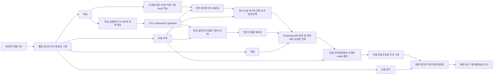

# 구조

[English](./architecture.md) | [프로젝트 개요](../README.ko.md) | [실측 결과](./results.ko.md)

이 프로젝트는 영어 글 두 개의 저자가 다른지(`0`) 같은지(`1`) 분류합니다. Dongmyung Park과 Juho Kim이 2026년 2월부터 5월까지 공동 개발했으며, 최초 문체 기반 앙상블과 RoBERTa-Large 노트북은 당시 개발 기록으로 보존합니다. 새로운 실험도 RoBERTa-Large 구조를 유지하며, 고정한 사전학습 가중치에서 시작해 모델 선택, 확률 보정과 최종 평가를 분리합니다. Large 두 모델의 대응 학습과 모델 세 개의 최종 4,708쌍 고정 평가를 완료했습니다. 고정한 배포 결정과 확인한 한계는 [실측 결과](./results.ko.md)에 설명합니다.

Windows와 Linux에서 모델 세 개를 각각 전체 4,708쌍으로 실행한 CPU 추론 6개를 모두 완료했습니다. ID 순서, 분류와 판정 여부, 개수, 혼동행렬, F1과 정확도 및 고정한 연결 정보가 최초 기준 결과와 일치했습니다. 원래 비교 대상인 주요 실수 지표는 `1e-6` 안에 있었으며 모든 진단값의 비트 단위 일치를 뜻하지 않습니다. 문체 모델의 CPU 간 검사는 통과했습니다. Large 두 모델은 변경하지 않은 `1e-5` 기준의 GPU와 CPU 확률 대조에 실패했습니다. Custom focal의 보정 확률 최대 차이는 Windows `1.80045428e-4`, Linux `1.09622536e-4`였으며 CE의 실패 기록도 보존합니다. 분류가 일치하더라도 엄격한 수치 재현은 실패 상태를 유지합니다. 공통 eager attention과 FP32 추론은 그대로이며 장치별 연산 차이일 가능성은 있지만 원인은 입증하지 못했습니다. CPU 자원 비용 관찰을 완료해 [CPU 요약](../reports/cpu-reproduction.json)에 연결했습니다. 같은 물리적 컴퓨터의 새 CLI 전체 프로세스를 측정했으며, 자원 측정의 정상 종료로 엄격한 수치 실패를 바꾸지 않습니다. 공개 모델 21개의 별도 비로그인 전달 검증은 [전달 기록](../reports/model-download-verification.json)에 있습니다.

## 문서 동일성과 데이터 분리

제공된 `data/train.csv`와 `data/dev.csv`에는 글 쌍과 라벨이 있습니다. `test.csv`와 `live.csv`는 라벨이 없는 추론 입력이므로 테스트 정확도를 계산할 수 없습니다. 새로운 데이터 분리 과정은 라벨이 있는 두 CSV를 합친 뒤 정해진 규칙을 적용합니다. 전처리 후 비어 버리는 글을 제외하고, 정규화한 글 쌍의 라벨이 서로 충돌하면 해당 그룹을 라벨 수정 없이 격리합니다. 라벨이 일치하는 중복 글 쌍은 원본 기록 ID가 가장 작은 한 쌍을 보존합니다.

문서 동일성은 원문, NFC 정규화와 공백 정리 결과, 두 최초 전처리 방식의 결과, 현재 사용하는 NFC 적용 후 전처리 결과를 함께 확인합니다. 동일한 것으로 확인된 문서는 전이 관계까지 연결합니다. 유지한 글 쌍은 라벨과 관계없이 두 문서를 연결하며, 하나의 연결 요소는 하나의 집합에만 배정합니다. 이 규칙으로 확인할 수 있는 동일 문서가 학습, 모델 선택, 보정, 최종 평가 집합에 걸쳐 재사용되는 일을 막습니다. 목표 비율은 각각 70%, 10%, 5%, 15%이며, 연결 요소의 크기 때문에 실제 개수는 정확한 비율과 다를 수 있습니다. 고정한 분리 명세에는 실제 개수, 클래스별 개수, 제외 기록, 원본 행 ID와 파일 해시가 들어 있습니다.

CSV에는 저자 ID나 도메인 라벨이 없습니다. 따라서 문서를 분리했다고 해서 저자, 도메인 또는 의미가 독립적으로 분리됐다고 주장할 수는 없습니다. 원본 CSV는 과거 개발에서도 사용했습니다. 여기서 최종 평가 집합은 이번 실험의 학습과 모델 선택에서 제외한 집합을 뜻하며, 과거에도 사용하지 않았던 데이터라는 의미는 아닙니다. 사전학습 데이터와의 중복이나 의미가 비슷한 문서의 중복은 별도의 진단에서 확인한 범위 외에는 알 수 없습니다.

실제 분리 명세는 라벨이 있는 원본 33,636행에서 전처리 후 빈 글을 포함한 86행과 라벨이 일치하는 중복 글 쌍 2,162행을 제외해 31,388행을 유지합니다. 선언한 동일성 규칙에서는 라벨이 충돌하는 글 쌍 그룹이 발견되지 않았습니다.

| 역할 | 글 쌍 수 | 다른 저자 | 동일 저자 |
|---|---:|---:|---:|
| 학습 | 21,972 | 11,039 | 10,933 |
| 모델 선택 | 3,139 | 1,577 | 1,562 |
| 보정 | 1,569 | 788 | 781 |
| 최종 평가 | 4,708 | 2,365 | 2,343 |

학습 전에 실제 고정 토크나이저로 31,388쌍을 두 순서 모두 인코딩하고, 같은 512토큰 longest-first 규칙을 적용했습니다. 인코딩한 입력 62,776개 중 서로 다른 fingerprint는 62,773개였으며, 집합 간 같은 fingerprint는 0개였습니다. 학습과 최종 평가 사이에서도 0개였습니다. 해당 토크나이저와 규칙에서 완전히 같은 모델 입력의 재사용을 배제한 것이며, 의미가 비슷한 글이나 저자 재사용까지 배제한 결과는 아닙니다.

## Transformer 입력

새 모델은 [`configs/experiment-plan.json`](../configs/experiment-plan.json)에 명시한 `FacebookAI/roberta-large`의 리비전 `722cf37b1afa9454edce342e7895e588b6ff1d59`입니다. 이진 분류 모델의 파라미터는 355,361,794개이며, 분류 헤드는 seed 378로 초기화합니다. CE와 custom focal은 동일한 최초 가중치 해시, 토크나이저 파일, 학습 기록, epoch별 데이터 순서, 입력 교환 증강과 최적화 설정을 공유합니다. 최초 과제 파인튜닝 가중치는 역사 자료로 보존하며 이번 대응 비교의 시작점으로 사용하지 않습니다.

실행 시 NFC 정규화 후 최초 RoBERTa 파이프라인의 이메일 헤더, 이메일 주소와 URL 제거 규칙을 적용하고 두 글을 표준 RoBERTa 텍스트 쌍으로 인코딩합니다. `longest_first` 방식으로 특수 토큰을 포함한 전체 길이를 512토큰으로 제한합니다. 원문에 있는 단서 중 일부는 모델 입력에서 잘릴 수 있으므로, 글 길이와 truncation 진단을 성능 수치와 함께 해석해야 합니다.

[입력 길이 검사](../reports/token-length-audit.json)는 고정 토크나이저로 전체 31,388쌍을 자르지 않고 실제 인코딩했습니다. 전체 1,292쌍(4.116%)과 최종 평가 4,708쌍 중 197쌍(4.184%)이 512토큰을 초과했습니다. 특수 토큰 4개를 포함한 길이의 중앙값은 293, 95백분위수는 492, 최댓값은 2,112토큰입니다. 이는 잘리는 입력 길이를 설명하며 예측 정확도를 측정한 결과는 아닙니다. 짧은 쪽의 글이 200단어 이상인 최장 길이 구간에는 최종 평가 사례가 5쌍뿐이므로 긴 글에 대한 성능을 일반화할 수 없습니다. [검사 코드](./reference-code/token_length_audit.py)는 최초 고정 토크나이저 파일을 검증하고, 모델 가중치나 레이블을 읽지 않고 입력 길이 검사를 재현합니다.

## 손실 비교

CE는 두 클래스의 일반적인 음의 로그 우도를 사용합니다. 직접 구현한 이진 비대칭 focal loss는 다음과 같습니다.

`L = mean(-(1 - p_y)^gamma_y * log(p_y))`

`p_y`는 정답 클래스의 softmax 확률입니다. 서로 다른 저자 클래스에는 `gamma_0=2`, 동일 저자 클래스에는 `gamma_1=1`을 적용합니다. 혼합 정밀도로 학습하더라도 FP32 log-softmax로 손실을 계산해 수치 안정성을 확보합니다. 최초 노트북은 이 클래스별 focal 방식을 ASL 또는 ASLoss라고 부르고 로그 계산 전에 확률에 `1e-8` 하한을 적용했습니다. 현재 계산은 하한을 제거했으므로 focal 원리는 유지하지만 극단적인 확률에서는 값이 달라질 수 있습니다. 공식 다중 라벨 ASL과 공식 `ASLSingleLabel`은 모두 존재하며, 이 코드는 어느 구현과도 같지 않습니다. [손실 함수의 명칭과 비교](./loss-terminology.ko.md)에서 가중치 구성의 차이와 보존한 `custom_asl` 식별자를 설명합니다. [ASL 논문](https://openaccess.thecvf.com/content/ICCV2021/html/Ridnik_Asymmetric_Loss_for_Multi-Label_Classification_ICCV_2021_paper.html)은 배경 자료이며 그대로 재현했다는 뜻은 아닙니다.

독립된 두 worker가 이미 배정된 T4를 하나씩 사용해 CE와 custom focal을 각각 학습합니다. 두 모델은 고정한 최대 6 epoch 안에서 같은 수의 epoch를 완료하며, 모델 선택 집합만 사용하는 공통 patience는 3입니다. 매 epoch가 끝나면 두 모델의 결과를 함께 확인하고, 어느 하나라도 개선되면 공통 대기 횟수를 초기화합니다. 둘 다 3회 연속 개선되지 않거나 상한에 도달하면 함께 종료합니다. 각 모델은 임계값 0.5에서 자신의 모델 선택 macro F1이 가장 높은 체크포인트를 저장하고, 정확한 동점에서는 먼저 저장한 체크포인트를 유지합니다. 선택된 최적 epoch는 달라도 완료한 학습 epoch 수는 같습니다. Microbatch 2와 최대 6 epoch는 두 과제 학습 전에 학습 기록만 사용한 자원 측정으로 유지했으며 검증이나 최종 평가 성능으로 선택하지 않았습니다.

FP16 forward pass, FP32 손실 계산, gradient checkpointing, microbatch 2와 유효 배치 32까지의 누적을 사용해 T4에서 Large를 학습합니다. 완료한 처리량 검사는 학습 기록과 폐기한 가중치만 사용해 microbatch 2, 8, 32를 비교했습니다. Microbatch 8의 처리량 배수 1.0244는 사전에 정한 채택 기준 1.05에 미치지 못했고 32는 더 느렸습니다. 유지한 학습 조건에는 실제 경과 9시간과 배정 worker 합산 18시간 상한을 적용합니다. Overflow로 건너뛴 optimizer update는 별도로 기록하므로 같은 시도 순서가 성공한 update 수까지 같다는 뜻은 아닙니다. 시간 제한이나 수치 계산에 실패하면 두 결과를 성공한 대응 비교로 공개하지 않습니다. CE와 custom focal의 손실값은 척도가 다르므로 custom focal의 손실값이 작다는 이유만으로 성능이 더 좋다고 판단할 수 없습니다.

## 문체 기반 입력 표현

다른 모델 계열은 최초 공동 개발한 XGBoost-LightGBM 앙상블을 유지합니다. 학습 집합에서만 맞춘 단어, 문자와 기능어 TF-IDF로 절대 차이, 원소별 곱과 cosine distance를 계산합니다. 최초 24개 문체 측정값은 절대 차이, 비율과 평균을 통해 72개 글 쌍 특징으로 변환합니다. 전체 특징, TF-IDF만 사용하는 특징, 문체 특징만 사용하는 경우를 비교해 각 특징 계열의 기여를 확인합니다.

별도 CPU 실험은 120분 안에서 4개 설정과 최대 8회 구성 모델 학습을 선언합니다. 각 500-tree pilot 세 쌍으로 특징 계열을 비교하고, 전체 특징 한 쌍에는 최초 상한인 XGBoost 7,000개와 LightGBM 2,000개 tree를 적용하되 early stopping과 시간 제한 callback을 사용합니다. 새로운 설정이나 가중치는 전체 특징 50/50 pilot 기준보다 모델 선택 macro F1이 0.002 이상 증가해야 채택합니다. 최종 XGBoost 가중치는 0.25, 0.5, 0.75 중 하나이므로 두 구성 모델을 모두 사용합니다. 단일 모델 결과는 진단용이며, 보정과 최종 평가 집합은 학습이나 설정 선택에 사용하지 않습니다.

## 입력 순서와 보정된 판정

AB 추론은 제공된 순서대로, BA 추론은 두 글을 바꾸어 입력합니다. 대칭 추론은 두 번의 logit 벡터를 평균한 뒤 softmax와 보정을 적용합니다. 같은 두 글의 순서를 바꿔도 수치 오차 범위에서 같은 점수가 나오지만, Transformer 추론이 두 번 필요합니다.

모델 선택 집합에서는 임계값 0.5의 원시 AB 손실 비교를 보존하고, 사전에 정한 규칙으로 각 모델의 입력 순서 정책을 선택합니다. 보정 집합에서는 세 모델을 각각 독립적으로 보정합니다. 클래스 간 logit 차이의 음의 로그 우도로 양수 temperature를 맞추고 macro F1 기준으로 분류 임계값을 선택하며, 판정 보류 임계값도 정합니다.

고정한 보정값과 이미 저장한 모델 선택 logits를 적용한 뒤, 모델 선택 집합에서 배포할 Large 파이프라인을 최종 비교합니다. Custom focal은 보정된 CE 파이프라인보다 macro F1이 0.002 이상 증가해야 이를 대체합니다. 원시 비교의 선택 모델과 보정된 파이프라인의 선택 모델을 모두 기록합니다. 보정 후 증가량에는 손실, 선택한 입력 순서와 독립적으로 맞춘 보정이 함께 반영되므로 손실만 바꾼 효과는 아닙니다. 이 비교에 추가 GPU 추론이나 파라미터 재학습은 필요하지 않습니다. 모든 최종 평가 추론 전에 이 결정을 포함해 함께 고정합니다. 목표 coverage나 정확도는 달성 여부를 확인할 선택 조건이며 최종 성능을 약속하는 값이 아닙니다.

출력은 제공된 데이터로 학습한 분류 점수입니다. Temperature scaling 후에도 임의의 새로운 글에서 두 사람의 저자가 같다는 사실을 증명하지는 않습니다. 판정을 보류한 글 쌍은 동일 저자나 다른 저자로 확정하지 않고 미판정 상태로 유지합니다.

## 모델 파일과 검증 범위

저장된 실행 모델은 가중치, 토크나이저 파일, 학습 설정과 파일 목록으로 구성됩니다. 모델 선택과 보정 결정, 분리 명세, 정확한 소스 스냅샷을 최종 평가 전에 함께 고정합니다. 저장 모델의 재검증은 이 파일을 다시 불러오는 과정이며 재학습과 구분합니다. 문서는 작은 합성 데이터의 정확성 테스트, 실제 저장 모델 재검증, 가중치를 폐기한 실행 가능성 검사와 과제 학습의 근거를 구분합니다.

Kaggle 입력은 허용한 소스, 라벨 데이터와 분리 명세의 압축 파일, CPU에서 학습을 마친 앙상블의 압축 파일 두 개로 구성합니다. Kaggle이 ZIP으로 제공하든 폴더로 풀어 제공하든 공통 검증 코드가 일치하는 후보 하나를 확인합니다. 각 파일의 크기와 SHA256을 검사하고 위험한 경로나 심볼릭 링크를 거부하며, 명세에 있는 파일만 새 작업 폴더에 복사합니다. 전체 GPU 작업은 검증한 CPU 앙상블을 재사용하므로 GPU 시간을 예약한 상태에서 CPU 모델을 다시 학습하지 않습니다.

사전에 선언한 불확실성 도우미는 고정한 최종 예측을 읽어 seed 378의 대응 bootstrap 1,000회를 수행합니다. 문서 연결 요소 전체를 함께 재표집하고 세 모델에 같은 표집을 적용합니다. 추가 추론, 재학습이나 재선택 없이 정확도, macro F1과 보정된 직접 구현 focal에서 CE를 뺀 macro F1 차이의 조건부 95% percentile 구간을 보고합니다. 이 구간은 제공된 데이터와 학습 seed 한 번에 관한 것이며 새 저자, 새 도메인이나 반복 학습의 불확실성을 추정하지 않습니다.
