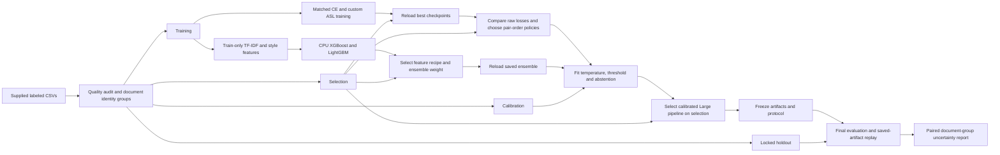

# Architecture

[한국어](./architecture.ko.md) | [Project overview](../README.md) | [Measured results](./results.md)

The task is to classify two English passages as different-author (`0`) or same-author (`1`). This project was developed jointly by Dongmyung Park and Juho Kim in February to May 2026. The original stylometric ensemble and RoBERTa-Large notebooks remain historical development work. The controlled pipeline retains the RoBERTa-Large architecture, starts from pinned pretrained weights, and separates model selection, calibration and final evaluation. Both matched Large training runs and the frozen evaluation of all three models on 4,708 locked-holdout pairs are complete. The [measured results](./results.md) describe the fixed deployment decision and observed limitations.

All six saved-model CPU inference executions are complete: all three models ran on all 4,708 locked-holdout pairs on Windows and Linux. Ordered IDs, class and acceptance decisions, counts, confusion matrices, F1, accuracy and frozen bindings matched the original references. The original selected-main floating metrics stayed within `1e-6`; this does not claim every diagnostic is bit-identical. The stylometric CPU-to-CPU checks passed. Both Large models failed the unchanged `1e-5` GPU-to-CPU probability checks. Custom-focal calibrated maximum differences were `1.80045428e-4` on Windows and `1.09622536e-4` on Linux; the CE failures are also preserved. Full strict numerical reproduction therefore remains failed despite classification agreement. Shared eager attention/FP32 inference is unchanged; device arithmetic drift is plausible, not a proven cause. CPU resource-cost observations are complete and linked in the [CPU summary](../reports/cpu-reproduction.json). They measure whole fresh CLI processes on one shared physical host; successful cost execution does not change strict numerical failures. The separate anonymous transport verification for all 21 public model files is in the [delivery receipt](../reports/model-download-verification.json).

## Data identity and separation

The supplied `data/train.csv` and `data/dev.csv` contain labeled passage pairs. `test.csv` and `live.csv` are unlabeled inference inputs and do not provide measured test accuracy. The split builder joins all labeled pairs before applying the new protocol. It excludes documents that become empty after cleanup, quarantines conflicting normalized unordered-pair labels without relabeling, and retains the smallest stable original record ID for consistent duplicates.

Document identities include exact text, NFC-normalized whitespace, both historical cleanup outputs and the current NFC-then-cleanup outputs. Aliases are joined transitively. Each retained text pair connects its two document identities regardless of its label, and every connected component is assigned to one split. This blocks passage reuse across train, selection, calibration and locked holdout under the verified identity rules. Target proportions are 70%, 10%, 5% and 15%; component sizes can make actual counts differ from exact percentages. The immutable manifest contains the actual counts, class support, exclusions, original row identities and source hashes.

The CSVs contain no author IDs or domain labels. Document separation does not establish author separation, domain separation or semantic independence. These CSVs were used during earlier development, so locked holdout means excluded from this experiment's task training and model selection. It does not mean the corpus was historically unseen. Pretraining overlap and semantic near duplicates remain unmeasured unless a diagnostic explicitly reports them.

The actual manifest retains 31,388 of 33,636 labeled rows after excluding 86 rows with empty cleanup outputs and 2,162 consistent unordered-pair duplicates. No conflicting-label pair groups were found under the declared identity policy.

| Role | Pairs | Different author | Same author |
|---|---:|---:|---:|
| Train | 21,972 | 11,039 | 10,933 |
| Selection | 3,139 | 1,577 | 1,562 |
| Calibration | 1,569 | 788 | 781 |
| Locked holdout | 4,708 | 2,365 | 2,343 |

Before training, the actual pinned tokenizer encoded all 31,388 pairs in both orders with the same 512-token longest-first policy. The 62,776 encoded inputs had 62,773 unique fingerprints and zero fingerprints shared across splits, including train versus locked holdout. This rules out exact encoded-input reuse under that tokenizer and policy; it does not rule out semantic near duplicates or reused authors.

## Transformer representation

The fresh model is `FacebookAI/roberta-large` at revision `722cf37b1afa9454edce342e7895e588b6ff1d59`, declared in [`configs/experiment-plan.json`](../configs/experiment-plan.json). The binary classifier has 355,361,794 parameters. The new task head is initialized with seed 378. CE and custom ASL receive identical initial state fingerprints, tokenizer files, records, epoch schedules, pair-swap augmentation and optimizer settings. Historical task-finetuned weights are preserved for historical use and are not the starting point for this controlled comparison.

The runtime performs NFC normalization, removes the original RoBERTa pipeline's email headers, addresses and URLs, and encodes the passages as a standard RoBERTa pair. `longest_first` truncation caps the combined sequence at 512 tokens, including special tokens. The original passages may therefore contain evidence that the transformer does not see. Length and truncation diagnostics describe that limitation separately from performance claims.

An input-only [token-length audit](../reports/token-length-audit.json) actually encoded all 31,388 untruncated pairs with the pinned tokenizer. Combined lengths exceeded 512 tokens for 1,292 pairs (4.116%), including 197 of 4,708 locked-holdout pairs (4.184%). The median was 293 tokens, the 95th percentile 492 and the maximum 2,112, including four pair-special tokens. This describes discarded input length, not prediction accuracy. The longest word-count diagnostic bin has only five holdout pairs, so it cannot establish long-passage robustness. The [reference helper](./reference-code/token_length_audit.py) verifies the original tokenizer assets and reproduces the input-only audit without loading model weights or labels.

## Loss comparison

CE uses the ordinary two-class negative log likelihood. The project's custom binary asymmetric focal loss uses:

`L = mean(-(1 - p_y)^gamma_y * log(p_y))`

Here `p_y` is the true-class softmax probability, `gamma_0=2` for different-author pairs, and `gamma_1=1` for same-author pairs. FP32 log-softmax makes the computation stable under mixed-precision training. The method retains the original project's class-dependent focal idea; it is not the published multi-label sigmoid ASL with probability clipping. The [original ASL paper](https://openaccess.thecvf.com/content/ICCV2021/html/Ridnik_Asymmetric_Loss_for_Multi-Label_Classification_ICCV_2021_paper.html) provides method context rather than a claim that this project exactly implements its recipe.

Two independent workers each use one already assigned T4: one trains CE and the other custom ASL. They complete equal numbers of epochs up to the frozen maximum of six, with selection-only patience three. At each epoch barrier, an improvement by either loss resets the shared patience; both stop when neither improves for three epochs or the cap is reached. Each model saves its own best selection macro F1 checkpoint at threshold 0.5, with exact ties retaining the earlier checkpoint. The selected epochs may differ while the completed epoch budget remains matched. Microbatch 2 and the six-epoch ceiling were retained from train-only resource evidence before either task run, without validation or holdout performance.

FP16 forward passes, FP32 loss computation, gradient checkpointing, microbatch 2 and accumulation to effective batch 32 make Large training feasible on a T4. The completed throughput probe compared microbatches 2, 8 and 32 using only train records and discarded weights. Microbatch 8's 1.0244 speedup did not meet the predeclared 1.05 adoption gate, and 32 was slower. The retained recipe keeps the nine-hour paired wall cap and 18-hour assigned-worker sum cap. Overflow-skipped optimizer updates are recorded explicitly; equal attempted schedules do not imply identical successful update counts. A timing or numerical failure prevents successful paired promotion. CE and custom ASL have different training-loss scales, so a smaller custom-ASL loss is not itself evidence of better performance.

## Stylometric representation

The second model family preserves the original joint XGBoost-LightGBM ensemble. Train-only word, character and function-word TF-IDF vectors form symmetric pair features using absolute differences, elementwise products and cosine distances. The 24 original style measurements form 72 pair features through absolute difference, ratio and mean. Full, TF-IDF-only and style-only views make the contribution of each feature family inspectable.

A separate CPU study declares four recipes and at most eight component fits within 120 minutes. Three 500-tree pilot pairs compare those feature views; one full-feature pair uses the original larger ceilings of 7,000 XGBoost and 2,000 LightGBM trees with early stopping and time callbacks. Selection can promote a recipe/weight candidate only with at least 0.002 macro F1 gain over the full-feature 50/50 pilot reference. Final XGBoost weights are 0.25, 0.5 or 0.75, so both ensemble components remain active. Single-component endpoints are diagnostics. Calibration and locked holdout are excluded from fitting and recipe selection.

## Pair order and calibrated decisions

AB inference encodes the passages in their supplied order. BA inference swaps them. Symmetric inference averages the two logit vectors before softmax and calibration. This makes the resulting score invariant to swapping the same two passages, within numerical precision, at the cost of a second transformer inference.

Selection preserves the fair raw AB loss comparison at threshold 0.5 and chooses each model's input-order policy by the predeclared rules. Calibration independently fits all three models: a positive temperature on class-margin logits by negative log likelihood, a classification threshold by macro F1, and optional abstention thresholds.

Using those fixed calibration parameters and the already stored selection logits, a final selection-only comparison chooses the deployed Large pipeline. Custom ASL replaces CE only with at least 0.002 macro F1 gain over the calibrated CE pipeline. Raw and calibrated-pipeline winners are both recorded. The calibrated gain includes loss, the selected orientation and independently fitted calibration, so it is not a loss-only effect. No extra GPU inference or parameter refitting is required for this comparison. The joint freeze follows this decision and precedes all locked-holdout inference. A confidence target is an objective to check, not a promised result.

The output is a dataset-trained classification score. Even after temperature scaling, it does not prove that two people are the same author on arbitrary new text. An abstained prediction should remain undecided rather than become an affirmative class label.

## Artifact boundaries

Model weights, tokenizer files, training configuration and file inventories form a saved runtime artifact. Selection and calibration decisions, the split manifest and the exact source snapshot are bound into a freeze before final evaluation. Replay loads these saved bytes rather than retraining the model. Final documentation distinguishes synthetic correctness tests, actual saved-model replay, the discarded capability probe and task training.

Kaggle input preparation uses two separate bundles: the allowlisted source, labeled data and manifest archive, and the already trained CPU ensemble archive. Kaggle may mount either archive as a ZIP or an expanded directory. A shared adapter requires one uniquely matching candidate, checks every declared size and SHA256, rejects unsafe paths and symlinks, and copies only allowlisted files into a fresh working directory. The full GPU job reuses the verified CPU ensemble instead of fitting it while GPU time is reserved.

The predeclared uncertainty helper reads already frozen final predictions and performs 1,000 paired bootstrap draws with seed 378. Whole document components are resampled together, and the same draws apply to all three models. It reports conditional 95% percentile intervals for accuracy, macro F1 and the calibrated ASL-minus-CE macro F1 difference without inference, refitting or reselection. These intervals describe this corpus and one trained seed; they do not quantify new-author, new-domain or repeated-training uncertainty.
