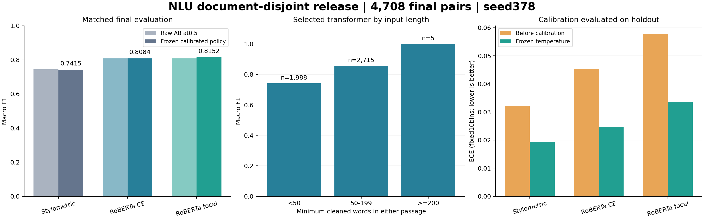

# Measured frozen evaluation

[한국어](./results.ko.md) | [Overview](../README.md) | [Protocol](./evaluation.md) | [Reproduction](./reproduction.md) | [Report comparator](./reference-code/compare_frozen_predictions.py)

The completed Kaggle release evaluates all 4,708 locked-holdout pairs after freezing every model, tokenizer, source file, split and calibration decision. This is a single-seed, document-disjoint experiment on the supplied corpus. Dongmyung Park and Juho Kim's original joint development period remains February to May 2026.

**Naming:** custom focal is the project's custom class-dependent binary focal loss, historically named ASL or ASLoss. The compatibility identifier remains `custom_asl`; this is not an official ASL or `ASLSingleLabel` experiment. The [terminology comparison](./loss-terminology.md) explains the official variants, preserved names and numerical-stability changes. Figures and immutable reports retain the focal label.

## Classification and deployment

| Model | Raw AB F1 | Chosen-order F1 | Frozen pipeline F1 | Accuracy | Correct |
|---|---:|---:|---:|---:|---:|
| Stylometric ensemble | 0.743335 | 0.743335 | 0.741498 | 74.1504% | 3,491 / 4,708 |
| Large CE (deployed) | 0.807724 | 0.808149 | 0.808383 | 80.8624% | 3,807 / 4,708 |
| Large custom binary focal (historical name: ASL) | 0.808153 | 0.816451 | 0.815170 | 81.5208% | 3,838 / 4,708 |

The first panel compares raw AB at threshold 0.5 with complete frozen pipelines, including their selected orientation and calibrated threshold. It does not isolate a calibration effect. The third panel holds each selected orientation fixed before and after temperature scaling. Length bars display their actual support, including only five ≥200-word cases.

Raw AB and chosen-order results use threshold 0.5 without temperature scaling. Chosen-order uses symmetric mean logits for both Large models and AB for the inherently symmetric stylometric representation. Frozen pipelines apply independently calibration-fitted temperature and decision thresholds. Every F1 above is the macro average of both classes, and every full-coverage metric includes the underlying binary prediction of abstained pairs.

CE remains the deployed transformer. Before holdout inference, the fixed calibrated pipelines scored 0.801199 for CE and 0.799145 for custom focal on the 3,139 selection pairs. Focal did not pass the predeclared +0.002 adoption gate. Its later holdout advantage of 0.006787 macro F1 (0.6787 percentage points, 31 more correct pairs) is reported without reselecting the model. It includes orientation and calibration effects and is not a loss-only effect or evidence that focal is always superior.

The historical Large macro F1 0.8348 and stylometric 0.7702 are development-set observations. The original split contains document reuse and train/development TF-IDF fitting. The new scores cannot measure a controlled performance increase or decrease against those historical values. The matched fresh CE/focal runs are the controlled comparison in this release.

## Probability calibration

| Model | ECE before → after | NLL before → after | Brier before → after | Temperature | Decision threshold |
|---|---:|---:|---:|---:|---:|
| stylometric | 0.032128 → 0.019479 | 0.481949 → 0.477097 | 0.162394 → 0.161535 | 0.834865 | 0.453506 |
| ce | 0.045364 → 0.024756 | 0.390351 → 0.379059 | 0.127160 → 0.124134 | 1.541728 | 0.497921 |
| custom_asl | 0.057828 → 0.033591 | 0.396182 → 0.380551 | 0.128212 → 0.124634 | 0.715183 | 0.531187 |

Before/after values use the same model, heldout records and selection-chosen orientation. The before columns use identity temperature. Temperature and classification thresholds were fitted only on the 1,569 calibration pairs and frozen before holdout. NLL, Brier score and ten-bin positive-class ECE improved for all three models. Classification did not improve uniformly: calibration and its fitted threshold added one CE correct pair but reduced focal by six and the stylometric ensemble by twelve relative to their chosen-order threshold-0.5 predictions. Probability calibration should not be described as a guaranteed F1 improvement.

ECE here uses ten fixed equal-width bins of same-author probability and positive-label frequency. It is different from predicted-label confidence versus accuracy. Both bin tables are preserved in the raw reports.

## Abstention

| Model | Accepted pairs | Coverage | Accepted accuracy | Abstentions | 80% / 90% target |
|---|---:|---:|---:|---:|---|
| stylometric | 3,858 / 4,708 | 81.9456% | 79.3675% | 850 | Not met |
| ce | 3,875 / 4,708 | 82.3067% | 86.3742% | 833 | Not met |
| custom_asl | 3,902 / 4,708 | 82.8802% | 86.6735% | 806 | Not met |

All three fixed abstention policies exceed 80% coverage, but none reaches 90% accepted accuracy on holdout. Thresholds were not adjusted after seeing that failure. CE's accepted predictions are correct for 3,347 of 3,875 accepted pairs (86.3742%), while 833 pairs produce an uncertain user-facing decision. Accepted accuracy always requires its coverage; abstaining does not increase the full-coverage correct count.

## Order and length diagnostics

Raw AB versus BA predictions disagree on 415 CE pairs (8.8148%) and 450 focal pairs (9.5582%) at threshold 0.5. The frozen symmetric Large policies have zero score gap and zero decision disagreement under passage swapping. The stylometric ensemble is already exactly invariant. Symmetric Large inference requires two forward passes; its runtime cost is measured separately.

| Shorter-passage words | Support | Stylometric F1 | CE F1 | Custom focal F1 |
|---|---:|---:|---:|---:|
| <50 | 1,988 | 0.693848 | 0.741795 | 0.746979 |
| 50–199 | 2,715 | 0.775839 | 0.856815 | 0.864755 |
| ≥200 | 5 | 0.761905 | 1.000000 | 1.000000 |

The ≥200-word slice has only five pairs. Its perfect Large result is a small descriptive observation and cannot establish reliable long-passage performance. The input-only tokenizer audit finds 197 of 4,708 holdout pairs (4.184%) exceeding 512 combined tokens before longest-first truncation. CE's shorter-than-50-word slice has F1 0.741795 versus 0.856815 for the 50–199-word slice; this association does not prove why individual errors occurred.

## Actual training resources

Both fresh RoBERTa-Large runs completed six matched epochs and retained their own best epoch-five checkpoint. They share initialization hash `ffe7ba5e9107a846e6c9303dc914893535a441412c12fee323111b17a754acd3`, the six recorded schedule fingerprints, seed 378, microbatch 2, effective batch 32 and pinned optimizer recipe. The common stop reason was the matched six-epoch cap. FP16 overflow skipped seven CE updates and six focal updates; equal attempted schedules do not imply identical successful-update counts.

The paired training parent took 23,025.254 seconds (6.3959 wall hours). Summed assigned-worker time was 45,993.036 seconds (12.7758 hours), including preparation and barrier waiting while GPUs remained assigned. The complete wrapper through frozen release took 27,171.02 seconds (7.5475 wall hours). These local scopes are not the official account quota delta or device-kernel-only utilization. The nine-hour paired-training and ten-hour complete-kernel caps were respected; no further GPU quality experiments were launched after this bounded run.

Actual full-run resource profiles show 6.09 GiB peak allocated GPU memory in the bounded profile phase for each worker. That profile value is not a measured peak over every epoch or local CPU process memory. The independent stylometric study took 95.06 minutes within its 120-minute cap; its selected 0.25 / 0.75 blend gained 0.005056 selection F1 over the 50/50 pilot, while the larger recipe failed to beat it and was not adopted.

## Evidence and interpretation

The [release summary](../reports/release-summary.json), [joint freeze](../reports/evaluation-freeze.json), [selection](../reports/selection.json), [calibration](../reports/calibration/), [ordered heldout predictions](../reports/locked-holdout/), [paired training report](../reports/training-report.json) and [execution timing](../reports/execution-timing.json) preserve exact values and bindings. The full wrapper timer excludes queueing and managed-runtime installation; the preserved original completion timer covers training only. The frozen joint identifier is `e8fc94ee17d7ea575ecf8002e3d104d1ec70600b68cc59239f1189b0b955f924`.

The [completed bootstrap](../reports/evaluation-bootstrap.json) uses the predeclared 1,000 paired draws over 3,207 whole document components, seed 378. Its conditional 95% percentile intervals are:

| Frozen model | Macro F1 interval | Accuracy interval |
|---|---:|---:|
| Stylometric | 0.723662–0.758584 | 72.3666%–75.8585% |
| CE | 0.792243–0.821863 | 79.2428%–82.2157% |
| Custom focal | 0.799702–0.828075 | 79.9990%–82.8109% |

The paired calibrated focal-minus-CE F1 difference is 0.006787, with interval 0.000063–0.013471. This is a report-only comparison of fixed complete pipelines conditional on the supplied corpus, its observed document components and one trained seed. It cannot isolate the loss, estimate variation over training seeds or new authors/domains, remove historical corpus exposure, or reselect deployment. Saved-model CPU replay and anonymous public delivery were verified separately from the Kaggle evaluation.

## Completed CPU replay

Saved-model verification is separate from training and the frozen Kaggle evaluation. All three saved models completed the full 4,708 pairs on Windows and Ubuntu 24.04 WSL2. Every run reproduced the ordered binary predictions, abstention decisions, F1 and accuracy. The stylometric ensemble passed the original tolerances on both platforms. Both Large models failed the original GPU-reference probability comparison:

| Model and CPU platform | Full CLI time | Maximum raw AB/BA difference | Maximum calibrated difference | Original strict result |
|---|---:|---:|---:|---|
| CE, Windows | 136.02 min | 5.430759e-5 | 1.789985e-5 | Fail |
| CE, Linux | 163.21 min | 1.272707e-5 | 8.806712e-6 | Fail |
| Custom focal, Windows | 146.82 min | 3.015516e-4 | 1.800454e-4 | Fail |
| Custom focal, Linux | 161.44 min | 1.838595e-4 | 1.096225e-4 | Fail |

The predeclared probability absolute tolerance remains `1e-5`. Linux CE's calibrated difference was within tolerance, but its raw-probability difference exceeded it. Custom focal's calibrated check exceeded tolerance on one of 4,708 records in each environment; the binary and abstention decisions still matched exactly. No tolerance, model, calibration or reference was changed after observing these results. Full-replay times use four CPU threads and batch size four and include CLI work; they are distinct from the separate one-thread batch-one latency benchmark.

Both transformer paths use eager attention, FP32 saved parameters and inference without autocast. CPU/GPU floating-point arithmetic differences are a plausible explanation, but this verification has not established a specific cause. Matched CPU resource measurements have completed; their scope and values are below. The two operating systems share one physical laptop and do not constitute independent external review. Separate [public download verification](../reports/model-download-verification.json) completed all 21 anonymous HTTP 200/size/SHA checks for the byte-identical Kaggle version-1 files. The original CPU replay receipts retain their local artifact origin; public delivery did not rerun inference or change the reference.

Author and domain IDs are absent. Document separation does not establish unseen-author or unseen-domain generalization. Historical corpus exposure, unmeasured semantic near duplicates, 512-token truncation, short-input weakness and the unmet abstention target remain limitations. The system predicts supplied pair labels; it cannot prove the identity of a person from arbitrary writing.

## Measured CPU latency and memory

The three models were measured sequentially on Windows, then on Ubuntu WSL2, on the same i7-11800H laptop with 64 GB RAM. Each fresh CLI used the same first 32 selection records, one CPU thread, batch size one, five warmup predictions and three timed repetitions. The fixed Large policy includes both AB and BA forwards, preprocessing and calibration. Model loading is reported separately.

| Platform and model | Pair p50 (ms) | Pair p95 (ms) | Model load (s) | Peak resident (GiB) |
|---|---:|---:|---:|---:|
| Windows, Stylometric | 29.17 | 73.28 | 3.21 | 0.272 |
| Windows, Large CE | 3601.84 | 5845.42 | 9.96 | 1.571 |
| Windows, Large custom focal | 3550.39 | 5777.96 | 9.27 | 1.571 |
| Linux, Stylometric | 24.68 | 74.45 | 2.69 | 0.320 |
| Linux, Large CE | 3436.91 | 5735.41 | 5.75 | 1.699 |
| Linux, Large custom focal | 3403.69 | 5915.93 | 5.33 | 1.701 |

These are limited same-host measurements on 32 nonrandom selection records, not population latency guarantees or a cold operating-system cache test. Windows PeakWorkingSetSize and Linux GNU-time maxRSS describe whole-process resident peaks including imports, libraries, models and preprocessing. Windows PeakPagefileUsage is process commit charge, not disk swapping. Different OS accounting limits memory comparisons.

The Windows-to-Linux CPU probability comparison failed at the unchanged `1e-5` tolerance; all discrete classifications and abstention decisions matched. The [CPU summary](../reports/cpu-reproduction.json) links all six raw evaluation results, original strict failures, expanded report comparisons and matched cost records. Successful cost measurement does not change the numerical reproduction result.
